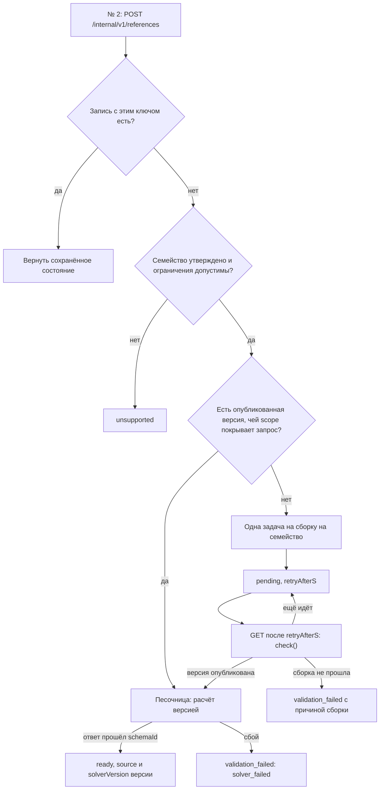

# Генерация солверов агентом на ГигаЧате: граница подключения

**Статус: план, кода генерации нет.** Сейчас сервис эталонов отвечает только готовыми фикстурами
(`providers/fixture.py`). Сгенерированный код нигде не создаётся и не запускается. Документ фиксирует,
как генерация подключится позже, не меняя API для № 2 и реестр. Владелец — разработчик № 3.

Что уже готово и на что опирается план:

| Шаг | Что | Где |
|---|---|---|
| C2, C3 | Реестр: один `referenceId` на ключ запроса, `pending` и опрос через GET, защита от гонок | `registry/` |
| C4 | Транспорт ГигаЧата, общий лимит вызовов, повторы, JSON-логи | `gateway/` |
| C6.1 | Интерфейс поставщика `ReferenceProvider.start/check` | `providers/base.py` |
| C6.2 | Метаданные версии солвера `SolverArtifact`, формат `solverVersion` | `contracts/v1/references/solverartifact.py` |

## Участники

| Кто | Что делает | Чего не может |
|---|---|---|
| Реестр (процесс API эталонов) | Хранит записи, отвечает № 2, вызывает поставщика | Не запускает чужой код |
| `GeneratingProvider` (в процессе API) | Ищет опубликованную версию, ставит задачу на сборку, отдаёт состояние | Не вызывает ГигаЧат сам |
| `solver-builder` (отдельный процесс, тот же образ) | Ведёт агента, проводит допуск, публикует версию | Не отвечает № 2 напрямую |
| Агент (цикл вокруг ГигаЧата внутри `solver-builder`) | Пишет код солвера по описанию семейства | Не видит закрытых тестов и работ учеников, не публикует |
| Песочница (одноразовый контейнер) | Запускает код кандидата или версии на одном входе | Нет сети, секретов, записи на диск |

Готовый фреймворк агентов не нужен: цикл короткий, а свой код сразу использует транспорт, лимит,
логи и тестовый транспорт без сети из C4.

## Вход

Агент получает только авторский контекст:

- `ProviderTask` из C6.1: условие после очистки, ограничения, `assignmentRev`, `familyHint`;
- описание утверждённого семейства: схема входа, `schemaId` ответа из `VALUE_SCHEMAS`, правила сравнения, открытые примеры;
- текст ошибки предыдущей попытки, если она упала на открытых примерах.

Агент никогда не получает: работу ученика, `assignmentId`, `taskId`, `attemptId`, закрытые тесты,
закрытые ответы датасета, ключи и токены. Перед вызовом ГигаЧата текст проходит ту же проверку на
персональные данные, что и в C4.2.

## Путь запроса

1. **`start(task)`.** Семейство берётся из `familyHint`. Если его нет или семейство не утверждено, ответ
   `unsupported`. Если ограничения выходят за описание семейства, тоже `unsupported`. Затем поставщик ищет
   действующую версию в таблице `refs.solver_versions`, чей `scope.covers(...)` истинно. Если она есть,
   поставщик считает эталон в песочнице. Если нет, он создаёт задачу в `refs.solver_builds`, не больше одной
   открытой на семейство, и отвечает `pending`.
2. **`check(task)`.** Реестр зовёт его, когда истёк обещанный `retryAfterS` (так уже работает C2). Поставщик
   читает состояние сборки. Опубликована версия: расчёт и `ready`. Сборка провалилась или истёк её срок:
   `validation_failed` с причиной. Иначе снова `pending`.
3. Пока идёт сборка, запросы разных заданий одного семейства получают свои записи в `pending`, а сборка у них одна.

## Агент и ГигаЧат

- `solver-builder` берёт задачу из `refs.solver_builds` с арендой и токеном, как журнал шлюза в C3.3:
  упавший процесс не держит задачу вечно, а чужая аренда не снимается.
- Вызовы идут через `LimitedTransport` и `GigaChatTransport` из C4 с отдельным промптом `solverAuthor.v1`.
  Промпт лежит рядом с кодом агента, им владеет № 3. Ответ модели — JSON с кодом, он проверяется по схеме,
  как `taskResult` в C4.4.
- Лимит ГигаЧата общий с проверкой работ, на старте один вызов одновременно. Сборка берёт слот с низким
  приоритетом и уступает проверке. Механизм (отдельный слот или очередь с приоритетом) выбираем, когда
  станет известен лимит тарифа.
- Цикл: модель пишет код, песочница гоняет его на открытых примерах, текст ошибки уходит в следующий вызов.
  Попыток не больше `SOLVER_AUTHOR_ATTEMPTS` (предложение: 3), у сборки есть общий срок. Исчерпаны попытки:
  `generation_failed`. Истёк срок: `generation_timeout`.
- В лог сборки пишутся только хеши и коды: `authorInputSha256`, sha256 кода и тестов, `modelId`, причина.
  Текст условия и код в лог не попадают.

## Допуск и публикация версии

**Владелец допуска — № 3, а решает только независимый шаг проверки, не агент.** Кандидат, прошедший
открытые примеры, запускается в новой песочнице на закрытых тестах семейства. Закрытые тесты лежат в S3 под
`references/families/<familyId>/closed/`, их читает только шаг допуска, в промпт они не попадают.

- Прошли все тесты:
  1. номер `N` выдаётся под блокировкой в PostgreSQL как следующий для семейства, `solverVersion = <familyId>.v<N>`;
  2. код и тесты пишутся в S3 под `references/solvers/<solverVersion>/` один раз, без перезаписи;
  3. рядом пишется `metadata.json` по схеме `SolverArtifact` (`source=generated`, `generation.modelId`);
  4. в `refs.solver_versions` появляется строка версии, и новые запросы начинают её использовать.
- Не прошли: сборка закрывается с `independent_tests_failed`, ожидающие записи получают `validation_failed`.
- Плохую версию снимают пометкой в `refs.solver_versions`. Объекты в S3 остаются, старые записи реестра
  сохраняют свой `solverVersion`, и старая проверка по-прежнему находит ровно тот код, которым считалась.
- Семейство утверждает команда. Оно готово к генерации, когда есть схема входа, схема ответа в
  `VALUE_SCHEMAS`, правила сравнения (их подтверждает № 2) и закрытые тесты. Закрытые тесты пишет команда,
  а не агент. Генерацию для семейства включает № 3.

## Песочница

Сгенерированный код не запускается в процессе API эталонов, воркера № 2 или `solver-builder`. Каждый запуск
идёт в новом контейнере, который создаёт `solver-builder` или поставщик через раннер.

| Ограничение | Значение (предложение) |
|---|---|
| Сеть | нет (`--network none`) |
| Секреты и переменные окружения | нет |
| Файловая система | только чтение, `/tmp` во временной памяти |
| Пользователь | не root |
| CPU / память / процессы | 1 ядро / 256 МБ / 64 |
| Время одного запуска | 10 с |
| Ввод и вывод | JSON на stdin и stdout, вывод не больше 64 КБ |

Ответ проверяется по `VALUE_SCHEMAS[schemaId]`. Любое нарушение (таймаут, падение, лишний или неверный вывод)
означает сбой: при допуске кандидат не проходит, при расчёте действующей версией ответ `solver_failed`.
Чем изолировать (обычный Docker, gVisor или nsjail), решаем при реализации.

## Состояния и причины

Сверено с ответами C2 (`openapi/references.json`) и тестами реестра. Строки с «да» воспроизводятся
фикстурами уже сейчас, остальные коды зарезервированы для генерации. Тест `tests/references/testGenerationDoc.py`
сверяет эту таблицу с контрактом и с работающим API.

| state | HTTP | reasonCode | Сейчас | Когда | Что дальше |
|---|---|---|---|---|---|
| `ready` | 200 | — | да | фикстура или опубликованная версия посчитала ответ | № 2 сравнивает ответ ученика с `value` |
| `pending` | 202 | — | да | идёт сборка версии или расчёт | № 2 повторяет GET через `retryAfterS` |
| `unsupported` | 200 | `unknown_task` | да | нет фикстуры для условия | задание уходит учителю |
| `unsupported` | 200 | `family_not_approved` | нет | нет `familyHint` или семейство не утверждено | задание уходит учителю |
| `unsupported` | 200 | `constraints_not_supported` | нет | ограничения вне описания семейства | задание уходит учителю |
| `validation_failed` | 200 | `independent_tests_failed` | да | кандидат не прошёл закрытые тесты | задание уходит учителю, № 3 смотрит лог сборки |
| `validation_failed` | 200 | `generation_failed` | нет | агент исчерпал попытки на открытых примерах | задание уходит учителю, № 3 смотрит лог сборки |
| `validation_failed` | 200 | `generation_timeout` | нет | истёк общий срок сборки | задание уходит учителю |
| `validation_failed` | 200 | `solver_failed` | нет | действующая версия упала или выдала ответ не по `schemaId` | задание уходит учителю, № 3 снимает версию |

`unsupported` и `validation_failed` конечны для своего `referenceId`, как в C2: повтор того же запроса вернёт
то же состояние. После публикации новой версии эталон появится у новой ревизии задания (`assignmentRev`).

## Ручная проверка

- Для № 2 любой `unsupported` или `validation_failed` означает «эталона нет»: задание помечается для учителя,
  ответ ученика с эталоном не сравнивается. Нуля вместо эталона не бывает (C2: у отказа нет `value`).
- № 3 разбирает провал по логу сборки: хеши входа, кода и тестов, `modelId` и причина.
- Если агент не справляется с семейством, разработчик пишет солвер сам. Он проходит тот же допуск и
  публикуется с `source=manual`, без `generation`.

## Что сделать до включения

1. Команда выбирает семейства и для каждого готовит схему входа, схему ответа, правила сравнения и закрытые тесты.
2. № 3 пишет `GeneratingProvider`, `solver-builder`, раннер песочницы, таблицы `refs.solver_versions` и
   `refs.solver_builds`, промпт `solverAuthor.v1`.
3. Поставщик выбирается явно настройкой, по образцу `GATEWAY_TRANSPORT`, без молчаливого перехода на платный API.
4. Пробный прогон с настоящим ГигаЧатом на одном семействе. После него № 2 прогоняет свой сценарий с настоящим эталоном.
