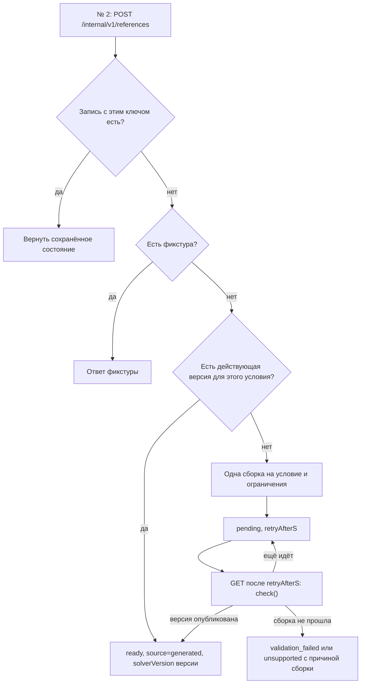

# Генерация солверов агентом на ГигаЧате

**Статус: сделано (C6.3), по умолчанию выключено.** Сервис эталонов сначала ищет готовую фикстуру
(`providers/fixture.py`). При `REFERENCES_PROVIDER=generating` задание без фикстуры получает свой солвер: его
пишет ГигаЧат, запускает песочница без сети, а принимает независимая перекрёстная проверка. API для № 2 и реестр
не менялись. Владелец — разработчик № 3.

Решение от 2026-11-20 («Солвер на задание»): солвер пишется для каждого задания учителя, а не только для
утверждённых командой семейств. Закрытых тестов команды для этого не нужно: их роль играет второй, независимо
написанный солвер. Это заменяет вариант с семействами из первой версии плана.

| Шаг | Что | Где |
|---|---|---|
| C2, C3 | Реестр: один `referenceId` на ключ запроса, `pending` и опрос через GET, защита от гонок | `registry/` |
| C4 | Транспорт ГигаЧата, общий лимит вызовов, повторы, JSON-логи | `gateway/` |
| C6.1 | Интерфейс поставщика `ReferenceProvider.start/check` | `providers/base.py` |
| C6.2 | Метаданные версии солвера `SolverArtifact`, формат `solverVersion` | `contracts/v1/references/solverartifact.py` |
| C6.3 | Поставщик, сборщик, агент, песочница, таблицы сборок и версий | `providers/generating.py`, `solvers/` |

## Участники

| Кто | Что делает | Чего не может |
|---|---|---|
| Реестр (процесс API эталонов) | Хранит записи, отвечает № 2, вызывает поставщика | Не запускает чужой код |
| `GeneratingProvider` (в процессе API) | Отдаёт фикстуру, опубликованную версию или открывает сборку | Не вызывает ГигаЧат, не запускает код |
| `solver-builder` (отдельный процесс, тот же образ) | Ведёт агента, проводит перекрёстную проверку, публикует версию | Не отвечает № 2 напрямую, не запускает код у себя |
| Агент (`solvers/author.py`) | Пишет код солвера для одного задания | Не видит работ учеников, идентификаторов и чужих солверов |
| `solver-sandbox` (отдельный контейнер) | Запускает код кандидата на одном входе | Нет сети, секретов, записи на диск |

Готовый фреймворк агентов не нужен: цикл короткий, а свой код сразу использует транспорт, лимит,
логи и тестовый транспорт без сети из C4.

## Вход агента

`AuthorData` (`gateway/transports/base.py`): условие после очистки, ограничения, способ решения (`approach`)
и, при повторе, свой прошлый код с текстом ошибки. Агент никогда не получает: работу ученика, `assignmentId`,
`taskId`, `attemptId`, ответы других солверов, ключи и токены. Условие с признаками персональных данных
(та же проверка, что в C4.2) в модель не уходит: сборка закрывается с `personal_data_suspected`.

## Путь запроса



1. **Ключ задания** — `t1:` и sha256 от условия и ограничений (`solvers/store.py`). Одно и то же условие в разных
   работах и ревизиях получает одну сборку и одну версию: ГигаЧат не спрашивают дважды.
2. **`start` и `check`** ищут действующую (не снятую) версию в `refs.solver_versions`. Есть: `ready` со значением,
   которое посчитал принятый солвер. Нет: строка в `refs.solver_builds` (уникальна по ключу задания) и `pending`
   с `retryAfterS` = `REFERENCES_BUILD_POLL_S` (10 с).
3. Проваленная сборка конечна для своего ключа: повтор того же условия вернёт ту же причину.

Grading ждёт `pending` без ограничения по числу опросов, а сборку ограничивает её срок
`SOLVER_BUILD_DEADLINE_S` (900 с): дальше она закрывается как `generation_timeout`.

## Агент и ГигаЧат

- `solver-builder` берёт сборку из `refs.solver_builds` с арендой и токеном, как журнал шлюза в C3.3:
  упавший процесс не держит сборку вечно, а чужая аренда не снимается. Аренда продлевается перед каждым шагом.
- Вызовы идут через `LimitedTransport` и транспорт из `GATEWAY_TRANSPORT` с промптом `solverAuthor.v1`
  (`solvers/prompts/`, им владеет № 3). Лимит ГигаЧата общий с проверкой работ (`refs.provider_slots`).
- Ответ модели — JSON `{"code": "..."}`; код в блоке Markdown тоже принимается. Код проверяется политикой
  (`solvers/policy.py`: только `math`, `fractions` и другие чистые модули, без файлов, `eval` и `__`-атрибутов),
  затем один раз запускается в песочнице. Ошибка формата, политики или запуска уходит модели в следующую попытку.
- Попыток у одного способа не больше `SOLVER_AUTHOR_ATTEMPTS` (3). Исчерпаны: `generation_failed`.
- 429, 503 и таймаут провайдера только откладывают сборку (`not_before`), пока не истёк её срок. Прямой отказ
  провайдера (ошибка входа, неверная область ключа) закрывает сборку как `provider_error` с текстом ответа
  провайдера в логе; такая сборка, как и `generation_timeout`, открывается снова при новом запросе условия.
- В лог сборки (`refs.solver_builds.log`) пишутся только способ, номер попытки, исход, sha256 кода и `modelId`.
  Текст условия и код в лог не попадают.

## Допуск: перекрёстная проверка

Решает не агент, а сравнение ответов независимых солверов (`solvers/builder.py`, `solvers/answers.py`):

1. Солвер `direct` (прямое решение) и солвер `independent` (другим способом: перебор, подстановка) пишутся
   отдельными вызовами, ни один не видит другого.
2. Ответы совпали — версия принимается. Сравнение точное: части ответа через `;` как мультимножество, числа как
   дроби (`0.5` = `1/2`, `−3` = `-3`), остальное как текст без пробелов и регистра. `0.333` и `1/3` различаются.
3. Не совпали — третий солвер `tiebreak` решает большинством. Ни с кем не совпал: `independent_tests_failed`.

Публикация:

1. номер `N` — следующий для семейства `task<16 hex ключа>` под блокировкой в PostgreSQL,
   `solverVersion = task….v<N>`;
2. в S3 (бакет `artifacts`) один раз, без перезаписи, пишутся `references/solvers/<solverVersion>/solver.py`,
   код проверяющих солверов, `tests.json` (перекрёстная проверка: вход, ожидаемый ответ, ответы и хеши
   проверяющих) и `metadata.json` по схеме `SolverArtifact` (`source=generated`, `generation.modelId`);
3. в `refs.solver_versions` появляется строка версии со значением, и запросы начинают её использовать.

Плохую версию снимают пометкой `withdrawn` в `refs.solver_versions`. Объекты в S3 остаются, старые записи реестра
сохраняют свой `solverVersion`. Новые запросы того же условия получают `solver_failed`.

## Песочница

Сгенерированный код не запускается в процессе API эталонов, воркера № 2 или `solver-builder`: у сборщика в
окружении ключ ГигаЧата, и дочерний процесс мог бы прочитать его из `/proc/1/environ`. Сборщик кладёт задание
в общий том `solver-jobs` (`<id>/job.json`), контейнер `solver-sandbox` отвечает `result.json` (`solvers/sandboxd.py`).

| Ограничение | Значение |
|---|---|
| Сеть | нет (`network_mode: none`) |
| Секреты и переменные окружения | нет: у контейнера их нет, у процесса солвера окружение пустое |
| Файловая система | только чтение, `/tmp` во временной памяти, `RLIMIT_FSIZE=0` |
| Пользователь | солвер работает под uid 10001, который не может писать в задания |
| CPU / память / процессы | 1 ядро / 256 МБ / 64 у контейнера; у солвера `RLIMIT_AS` 256 МБ, `RLIMIT_NPROC` 0 |
| Время одного запуска | 10 с по часам и 10 с CPU |
| Ввод и вывод | JSON на stdin и stdout, вывод не больше 64 КБ |

Внутри солвер получает встроенные функции без `open`, `eval`, `exec`, `getattr` и импорт только из списка
политики (`solvers/harness.py`). Это вторая линия: граница — сам контейнер. Ответ должен быть `scalar.v1`
`{"exact": "..."}` (математика) или `{"value": ..., "unit": "..."}` (физика, см. ниже); любое нарушение (таймаут, падение, лишний или неверный вывод) — неудачная попытка.
`LocalSandbox` (тот же запуск без контейнера) только для тестов: со `GATEWAY_TRANSPORT=gigachat` сборщик его не примет.

## Физика

Предмет задания (`subject`: `math` или `physics`) учитель выбирает при создании КР; он идёт в событии
`assignment.published`, а `grading` кладёт его в ограничения запроса эталона: `constraints = {"subject": "physics"}`.
Задания математики сохраняют пустые `constraints`, поэтому их ключи и солверы не изменились. Предмет входит в ключ
задания: одно и то же условие в математике и в физике — два разных солвера.

| | Математика | Физика |
|---|---|---|
| Промпт автора | `solverAuthor.v1` | `solverPhysics.v1`: СИ, константы из условия или таблицы учебника, все стадии процесса |
| Ответ солвера | `{"exact": "2; 3"}` | `{"value": 84000, "unit": "Дж"}` |
| Эталон | `scalar.v1` | `quantity.v1` `{"value": "84000", "unit": "Дж", "relTolerance": 0.02}` |
| Совпадение двух солверов | точное (`answersAgree`) | после перевода в СИ, расхождение не больше 0,5 % (`valuesAgree`) |
| Промпт проверки работы | `review.v2` | `review.v3`: формула, перевод единиц, подстановка, допуск `relTolerance` |

Единицы разбирает `contracts/v1/references/quantity.py`: 84 кДж = 84 000 Дж, 1000 Н = 1 кН, 500 г = 0,5 кг,
40 % = 0,4, Дж/(кг·°C) = Дж/(кг·К). Итог ученика оценивает модель (решение 2026-11-20): она получает эталон
с единицей и допуском и по `review.v3` считает верным любой эквивалентный ответ в пределах `relTolerance`.
Допуск 2 % у ученика шире, чем 0,5 % у солверов: ученик округляет и берёт табличные константы, а два солвера
одной задачи считают по одним данным. Пример — `docs/samples/fizika-teplota` (`uv run python -m dataset.heat`).

## Состояния и причины

Сверено с ответами C2 (`openapi/references.json`) и тестами реестра. Строки с «да» в столбце «Сейчас»
воспроизводятся одними фикстурами, остальные дают генерация (`tests/references/testSolverGeneration.py`).
Тест `tests/references/testGenerationDoc.py` сверяет эту таблицу с контрактом и с работающим API.

| state | HTTP | reasonCode | Сейчас | Когда | Что дальше |
|---|---|---|---|---|---|
| `ready` | 200 | — | да | фикстура или опубликованная версия дала ответ | № 2 сравнивает ответ ученика с `value` |
| `pending` | 202 | — | да | идёт сборка солвера | № 2 повторяет GET через `retryAfterS` |
| `unsupported` | 200 | `unknown_task` | да | нет фикстуры, а генерация выключена | задание уходит учителю |
| `unsupported` | 200 | `personal_data_suspected` | нет | в условии похоже на персональные данные, модель не вызывалась | задание уходит учителю |
| `validation_failed` | 200 | `independent_tests_failed` | да | независимые солверы дали разные ответы | задание уходит учителю, № 3 смотрит лог сборки |
| `validation_failed` | 200 | `generation_failed` | нет | агент исчерпал попытки или провайдер отказал | задание уходит учителю, № 3 смотрит лог сборки |
| `validation_failed` | 200 | `generation_timeout` | нет | истёк общий срок сборки | задание уходит учителю; новый запрос условия запускает сборку снова |
| `validation_failed` | 200 | `provider_error` | нет | ГигаЧат отказал сразу: вход, ключ, область (`GIGACHAT_SCOPE`) | задание уходит учителю; № 3 смотрит текст ошибки в логе сборки; новый запрос условия запускает сборку снова |
| `validation_failed` | 200 | `solver_failed` | нет | версия для условия снята | задание уходит учителю |

`unsupported` и `validation_failed` конечны для своего `referenceId`, как в C2: повтор того же запроса вернёт
то же состояние.

## Ручная проверка

- Для № 2 любой `unsupported` или `validation_failed` означает «эталона нет»: задание помечается для учителя,
  ответ ученика с эталоном не сравнивается. Нуля вместо эталона не бывает (C2: у отказа нет `value`).
- № 3 разбирает провал по логу сборки: способ, попытка, исход, хеш кода, `modelId` и причина.
- Если агент не справляется с заданием, разработчик пишет солвер сам: он публикуется с `source=manual`, без
  `generation`, той же строкой в `refs.solver_versions`.

## Включение

Тесты и CI работают на тестовом транспорте (`fixtures/solverAuthors.json`) без сети. Платная модель включается
только явно, в своём `.env` в корне репозитория (ключ в git не попадает):

```
GATEWAY_TRANSPORT=gigachat
REFERENCES_PROVIDER=generating
GIGACHAT_AUTH_KEY=<ключ авторизации из кабинета ГигаЧата>
GIGACHAT_CONTAINER_CA_BUNDLE=/certs/russian_trusted_root_ca.pem
```

Сертификат кладётся в `deploy/certs/` (там README). Запуск из корня репозитория:

```
docker compose --env-file .env -f deploy/compose.yaml --profile full up -d --build --wait
```

Что ещё не сделано: приоритет проверки работ над сборками в общем лимите ГигаЧата (сейчас слот общий, без
приоритета) и солверы на семейство заданий, которые переиспользуются между разными условиями.
